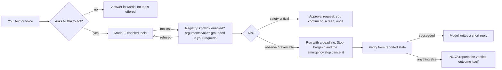

# Actions: NOVA acting on your computer and devices

Since 0.4.1, a request such as **“Hey NOVA, open Spotify and play Tiakola — Vie de Pirate”** is carried out, not
explained. You can type it or say it. The model picks a registered tool, NOVA validates it, runs it with a deadline,
checks the outcome where the integration allows, and tells you what actually happened.

## Why 0.4 answered with instructions

Diagnosed on 2026-10-18 from the code, the audit log (no `tool.*` event had ever been recorded) and the conversation
history:

1. **The model was never given any tools.** `AIProvider.stream()` was text in, text out, and the conversation
   pipeline never consulted the tool registry.
2. **The system prompt said “You cannot take actions yourself”.** llama3.2 did what it was told.
3. **The only route to Spotify was a voice-only pattern match in the browser** (`spotifyVoiceCommand`). Typed
   requests never reached it, and “open Spotify and play X” matched none of its patterns.
4. **Desktop control was off.** `.env` had no `NOVA_DESKTOP_CONTROL_ENABLED`, so the default was `false`.
5. **The Spotify tool itself was broken:**
   - Its fallback path raised `UnboundLocalError` (`os` was imported in only one branch).
   - `play_pause` was not handled.
   - Playback was checked only once, right after the play request, so a successful play could be reported as failed.
   - `.json()` was called on empty (HTTP 204) responses.
   - “Premium required” and “no device” were not told apart.
   - It played the first search result without ever asking which track was meant.

All of these are fixed. The client-side pattern matcher is gone: typed and spoken requests now go through the same
pipeline.

## How a request becomes an action



- **Offered only when relevant.** Tools are offered only when your message asks NOVA to do something. Questions
  (“how do I open…?”, “explain…”) are answered without tools.
- **Several steps per request, with limits:** at most 5 model rounds and 6 tool calls, the same call at most twice,
  and 240 s for the whole request.
- **Each tool has its own deadline** (Spotify 45 s, apps 15 s, Home Assistant 20 s). A tool that overruns is told
  to stop and is reported as `timed_out`.
- **Stopping is immediate.** *Stop*, Esc, barge-in (“hey nova” while NOVA works) and the emergency stop all cancel
  the running tool.
- **The model never runs anything itself.** It can only request registered tools. There is no shell tool, and
  commands only ever become approval requests.
- **Every execution is audited:** tool, outcome, duration, risk and whether it was verified. Songs, URLs and other
  arguments are never written to the audit log.

### What you see and hear

Each reply lists the actions NOVA took, with their real status:

| Status | Shown as | Meaning |
|---|---|---|
| `succeeded` | **Done · verified** / **Done** | Done. “verified” means the integration confirmed it (for example Spotify reports the track playing). |
| `unverified` | **Not confirmed** | The request was accepted, but NOVA could not confirm the result (for example Windows media keys). |
| `needs_input` | **Needs your choice** | Ambiguous. NOVA lists the options; answer “the first one”, “number two” or the title. |
| `needs_authorization` | **Needs a connection** | An account must be connected first. A *Connect* button starts the supported flow. |
| `awaiting_approval` | **Waiting for your approval** | A safety-critical action is queued in **Approvals**. It has not been done. |
| `unavailable` / `failed` / `denied` / `timed_out` / `cancelled` | Unavailable / Failed / Refused / Timed out / Stopped | The precise reason, and what to do about it. |

- **Spoken requests:** NOVA speaks the tool's own result message, not the model's paraphrase of it.
- **When something doesn't succeed:** NOVA writes the reply itself from the verified outcome. In live tests, llama3.2
  turned a refused Spotify call into “You need to connect to your Spotify account. Which account would you like to
  use?”, which was untrue; that can no longer happen.

### Safeguards for small local models

Each of these was added after a live test with llama3.2 (3B) on this PC. None of them can start an action on its own.

| Problem seen live | Safeguard |
|---|---|
| Opened Wikipedia when asked to explain photosynthesis. | Tools are offered only for requests to act (`services/intent.py: looks_like_action`). |
| Raised the system volume for “turn on the kitchen lights”. | A call runs only if your request mentions what the tool acts on (`grounded`). Refused calls never run and are not shown. |
| Sent `action: "open"` together with the song, swapped title and artist, or wrote `"null"` as the artist. | The Spotify schema normalises these. The search uses all the words you said, whichever field the model put them in. |
| Answered “the first one” by calling the wrong tool. | NOVA resolves your choice among the options it listed and plays that exact Spotify item by its ID (`resolve_choice`). |
| Wrote a tool call as text (`{"name": "play_track", …}`). | Text naming a registered tool is executed through the registry with full validation. Imitations of other tools are never shown as a reply. |

Larger models (mistral 7B, or Claude) need these less, but they are harmless with them.

## Built-in actions

| Tool | Does | Risk | Verification |
|---|---|---|---|
| `spotify_control` | Open Spotify; play a track, playlist or artist; pause, resume, next, previous, volume | reversible | Spotify's reported player state: the requested item playing, paused, new track, volume |
| `open_app` | Open an approved app. Defaults: Spotify, Calculator, Settings, Notepad/Notes, File Explorer, Microsoft Word/Word/MS Word, VS Code/Visual Studio Code; add aliases and apps with `NOVA_DESKTOP_APPS` | reversible | The app's process appears when it has a detectable process |
| `open_website` | Open an http(s) page on an allowed host in your default browser | reversible | Not verifiable (Windows opens the browser) |
| `open_file` | Open a document, image or media file from the conversation's project | reversible | Not verifiable |
| `open_project` | Open the project folder in VS Code or File Explorer | reversible | VS Code's process appears |
| `media_control` | System media keys (play/pause, next, previous, volume, mute) | reversible | Always **Not confirmed** |
| `run_project_command` | Ask to run an allowlisted command (for example the tests) in the project | safety-critical | The existing command runner, after your approval |
| `home_status` | Read a Home Assistant device's state | observe | Home Assistant's state |
| `home_control` | Control a Home Assistant device | per device (see below) | The device's reported state afterwards |

Restrictions that apply to every tool:

- Nothing is launched with arguments.
- Files outside the project, and anything executable (`.exe`, `.bat`, `.ps1`, `.js`, `.py`, `.lnk`, …), are never
  opened.
- Websites are limited to `NOVA_BROWSER_ALLOWED_HOSTS`, and URLs with embedded credentials are refused.

## Spotify

**Setup**

1. Create a Spotify Developer app.
2. Set `NOVA_SPOTIFY_CLIENT_ID` and add the redirect URI `http://127.0.0.1:8000/api/spotify/callback` in the
   dashboard.
3. Set `NOVA_DESKTOP_CONTROL_ENABLED=true`.
4. Restart NOVA.
5. Go to **Settings → Voice → Spotify → Connect Spotify**.

NOVA uses PKCE and keeps its tokens encrypted with Windows DPAPI. It requests only the playback-state,
playback-control and playlist-read scopes.

**What NOVA does for “play X”**

1. Searches Spotify for everything you said, then matches the results against your words. Accents and ligatures
   (“Cœur”) are handled.
2. Plays the best title match, preferring the artist you named.
3. When no title matches, lists Spotify's top three results and asks which one you want.
4. If no playback device is available, opens the Spotify app and waits up to 12 s for it to appear.
5. Starts playback on that device.
6. Reports success only once Spotify's own player state shows the item playing. It checks for up to 6 s.

| Blocker | What NOVA says / does |
|---|---|
| Not connected | **Needs a connection**, with a *Connect Spotify* button. |
| Authorization expired or revoked | Asks you to reconnect. |
| No device even after opening the app | Asks you to sign in to Spotify on this PC, or open Spotify on another device. |
| Premium required (`PREMIUM_REQUIRED`) | Explains it and opens the track in the Spotify app for you to press play (**Not confirmed**). |
| Rate limited | One retry if Spotify asks to wait ≤ 3 s; otherwise reported. |
| Accepted but not confirmed | **Not confirmed**, never “playing”. |
| Not connected, for pause/next/volume | Sends the Windows media key instead and says it can't confirm. |

## Smart home and physical devices (Home Assistant)

NOVA controls physical devices through a local **Home Assistant** hub only. Hardware and microcontrollers (for
example ESPHome boards) reach NOVA by being added to Home Assistant. NOVA has no other device integration. Without
this configuration, NOVA says so instead of pretending.

```env
NOVA_HOME_ASSISTANT_URL=http://homeassistant.local:8123
NOVA_HOME_ASSISTANT_TOKEN=<a long-lived access token from your Home Assistant profile>
NOVA_HOME_ASSISTANT_ENTITIES=light.kitchen, light.porch, switch.desk_lamp=reversible, lock.front_door, climate.living, sensor.outdoor_temperature
```

Only the listed entities are reachable. They fall into three risk classes:

| Class | Devices | What happens |
|---|---|---|
| Observe | `sensor`, `binary_sensor` | Read only. |
| Reversible | `light`, `fan`, `media_player`, `scene`; a `switch` you mark `=reversible` | Runs immediately, then is verified from the reported state. |
| Safety-critical | `lock`, `cover` (garage doors, gates, blinds), `climate`, `water_heater`, `valve`, `siren`, `humidifier`, and `switch` by default (it may power a heater or a machine) | Queued in **Approvals**; runs once after you confirm on screen, never by voice. |

- You can make any device stricter with `=critical`.
- Only switches can be relaxed to reversible. Locks, covers, climate and the other safety-critical classes cannot.
- Thermostat set points are limited to 5–30 °C.
- Devices reported offline are not sent commands.
- Physical devices keep their own manual controls. NOVA never disables them.

## Emergency stop

**Settings → Actions → Emergency stop** (`POST /api/actions/emergency-stop`) does four things at once:

- cancels running actions;
- cancels running project commands;
- rejects device requests waiting for approval;
- **pauses control** until you press *Resume device control*.

While paused, NOVA can still read states, but it refuses every control action. The pause is saved, so it survives a
restart.

## Isolated browser (optional)

Install the optional Playwright dependency and its Chromium binary from `backend/`:

```powershell
.\.venv\Scripts\python.exe -m pip install -r requirements-browser.txt
.\.venv\Scripts\python.exe -m playwright install chromium
```

With `NOVA_DESKTOP_CONTROL_ENABLED=true`, NOVA exposes `browser_open`, `browser_inspect`, `browser_search`, and
`browser_open_link` through the same typed tool registry and action loop. It opens a **visible**, NOVA-managed
incognito context; it does not load your personal browser profile or its cookies. Browser navigation is limited to
approved HTTPS hosts on the standard port. NOVA checks the hostname and its resolved addresses before navigation
and checks each routed request, including subresources and redirects. Localhost, IP literals, private and special-use
addresses, unsupported schemes, downloads, and form submission are blocked or unsupported. Page text is bounded and
credential-like URL parameters are refused. Page text is bounded and passed to the model as untrusted page content.
A page cannot grant permissions or authorize another action.

The browser adapter runs in NOVA's backend process under the current Windows account. It is not an OS sandbox. DNS
resolution is checked before requests, but an in-process browser cannot guarantee protection against a compromised
host resolver or a DNS change between the check and the browser's connection. Sites requiring off-list CDNs may render
incompletely. NOVA does not automate CAPTCHAs, MFA, account changes, purchases, or submissions.

The automated browser policy tests use mocked DNS and browser objects; they do not prove behavior against live sites,
real Chromium, or Windows networking. If Playwright or Chromium is missing, the catalog reports browser tools as
unavailable (or the operation explains the missing browser prerequisite).

## What runs where

| Part | Runs | Sends data to |
|---|---|---|
| Intent check, tool registry, validation, approvals, audit, Windows actions | NOVA backend on this PC (`127.0.0.1`) | Nothing |
| The model that chooses tools | Ollama on this PC, or Anthropic (cloud) if you select Claude | Anthropic only when Claude is selected: your messages, tool descriptions and tool results |
| Spotify control | NOVA backend → Spotify Web API | Spotify: search text and playback commands, only after you connect |
| Home Assistant | NOVA backend → your Home Assistant URL | Your hub only |
| Speech | See [VOICE.md](VOICE.md) | Browser speech recognition may use Google or Microsoft; the wake phrase is local |

### Why there is no separate Windows agent process

Windows actions run inside NOVA's backend, which already runs locally as your Windows user. A separate agent process
under the same account would add no real isolation, because anything able to compromise the backend could also
drive that agent. The boundary is instead the narrow, typed tool set:

- no shell and no arguments to launched programs;
- allowlists for apps and websites;
- files confined to the project;
- schema validation;
- approvals for consequential actions.

Real OS-level isolation would require running such an agent under a different, restricted Windows account. That is
not implemented.

## Configuration

| Variable | Default | Meaning |
|---|---|---|
| `NOVA_DESKTOP_CONTROL_ENABLED` | `false` | Enables the Windows tools (Spotify, apps, websites, files, project, media keys, project commands). |
| `NOVA_SPOTIFY_CLIENT_ID` | *(empty)* | Your Spotify app's client ID (PKCE; no secret). |
| `NOVA_DESKTOP_APPS` | *(empty)* | Extra apps: `name=C:\path\App.exe\|app.exe\|alias1,alias2;name=scheme:\|process.exe\|alias`. User-configured absolute executable/shortcut paths and registered URI schemes only; no shell or arbitrary arguments. |
| `NOVA_BROWSER_ALLOWED_HOSTS` | localhost, 127.0.0.1, google.com, youtube.com, github.com, stackoverflow.com, wikipedia.org, developer.mozilla.org, docs.python.org, open.spotify.com | Hosts `open_website` may open (subdomains included). |
| `NOVA_HOME_ASSISTANT_URL` / `_TOKEN` / `_ENTITIES` | *(empty)* | Home Assistant hub, long-lived token, and the devices NOVA may use. |

Tool use needs a model that can call tools. In Ollama that means **llama3.2** or **mistral**, not **phi**; Claude
also works. **Settings → Capabilities → Actions** and **Settings → Actions** show what is ready and why not.

## Testing

**Automated** (mocked HTTP and OS; they prove NOVA's logic, not a live service):

| File | Covers |
|---|---|
| `tests/test_agent.py` | Model-driven tool choice through the chat API, invalid and unknown calls refused, approvals, failures reported as failures, premature claims hidden, honest replies, loop limits, choice resolution, text tool calls, emergency stop, cancellation, deadlines, audit without arguments. |
| `tests/test_spotify.py` | Your exact request, ambiguity, swapped fields, misremembered title (with Spotify's real results), authorization, no device / app launch, Premium, unconfirmed playback, rate limits, 204 responses, cancellation, scopes. |
| `tests/test_tools.py` | The registry: schema, risk, approval gating, deadlines, cancellation, pause, API authentication and CSRF, audit. |
| `tests/test_desktop_tools.py` | Windows tools and the `UnboundLocalError` regression. |
| `tests/test_home_assistant.py` | Risk classes, verification, approval-only devices, bounds, offline devices, bad token, unreachable hub. |
| `tests/test_intent.py` | The small-model safeguards. |
| `tests/test_providers.py` | Ollama and Claude tool calling. |
| `src/test/chat.test.tsx`, `voice.test.tsx`, `actions.test.tsx` | Action cards, spoken verified results, a single pipeline for voice, the emergency stop UI. |

### Live test (recorded 2026-10-18, this PC)

The live test used NOVA's real chat API and agent, local Ollama **llama3.2**, the owner's real Spotify account and the
real Windows launcher, with a throwaway NOVA database
(`scratchpad/live_spotify_test.py`, not shipped).

| Step | Result |
|---|---|
| “Hey NOVA, open Spotify and play Tiakola — Vie de Pirate.” | llama3.2 called `spotify_control` (`play_track`). Spotify has no Tiakola track named “Vie de Pirate”, so NOVA answered in 37 s (cold model): *“I'm not sure which track you mean… Spotify's top results: 1. Cœur De Pirate by Tiakola; 2. AF1 NOUVO by Tiakola; 3. Mode de vie by Tiakola. Which one should I play?”* |
| “the first one” | NOVA resolved the choice and played `spotify:track:3KfdpLKJxBGrUnCw8KBOCR` on LAPTOP-EXPERTIZ, **verified** from Spotify's player state, in 4.3 s: *“Playing Cœur De Pirate on Spotify (LAPTOP-EXPERTIZ).”* |
| Independent check | `GET /me/player`: `is_playing: true`, “Cœur De Pirate” by Tiakola on LAPTOP-EXPERTIZ. |

Earlier live runs found the problems that the safeguards above now handle:

- `market=from_token` needed a scope NOVA does not request, so Spotify answered HTTP 403;
- llama3.2 swapped the title and the artist;
- llama3.2 paraphrased a failure into something untrue.

A pipeline probe with the OS and Spotify simulated confirmed four more behaviors:

- “pause the music” paused, verified;
- “open the calculator” opened it;
- two questions were answered without tools;
- “turn on the kitchen lights” ran nothing.

**Repeat it yourself**

1. Set `NOVA_DESKTOP_CONTROL_ENABLED=true` and restart NOVA.
2. Connect Spotify.
3. Open the Spotify app on this PC.
4. Choose **llama3.2** (or Claude) in **Models**.
5. Say or type the request.

The action card should read **Done · verified** only when Spotify really plays the track. Pause Spotify, then ask
again to see the honest **Not confirmed** / **Unavailable** paths.

## Limitations

- **Small models are slow and imperfect.** The first request after llama3.2 loads took 37–50 s on this PC (prompt
  processing of the tool definitions on CPU); later ones took 4–17 s. The model still sometimes picks odd arguments.
  The safeguards stop wrong actions, but some requests will end in an honest “couldn't” instead of the action.
- **Intent detection has gaps.** Deciding whether a message asks NOVA to act is an English/French word list. A
  request with no action verb (“some Tiakola would be nice”) is answered in words. Rephrase it as “play …”.
- **Some outcomes can't be confirmed.** Website, file and Explorer openings, and media keys, cannot be verified;
  NOVA says so.
- **Spotify Premium.** Spotify may require Premium for Web API playback. This was not observed on the tested account.
- **Home Assistant is untested against a real hub.** It was tested only with a mocked Home Assistant API.
- **No live tests with Claude or mistral.** Claude tool calling was tested only against a mocked API, and mistral was
  not tried live.
- **Windows only, and no OS sandbox.** Desktop actions run in the backend under your Windows account (see above).
