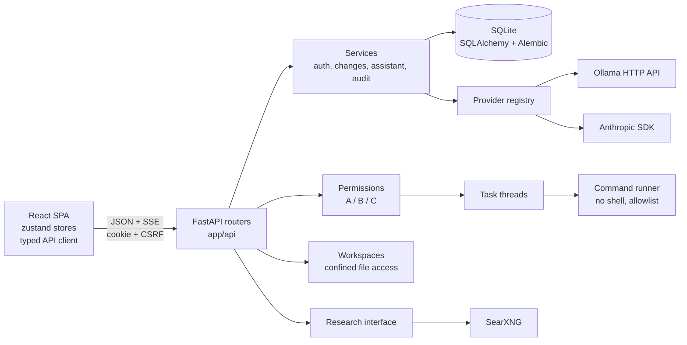
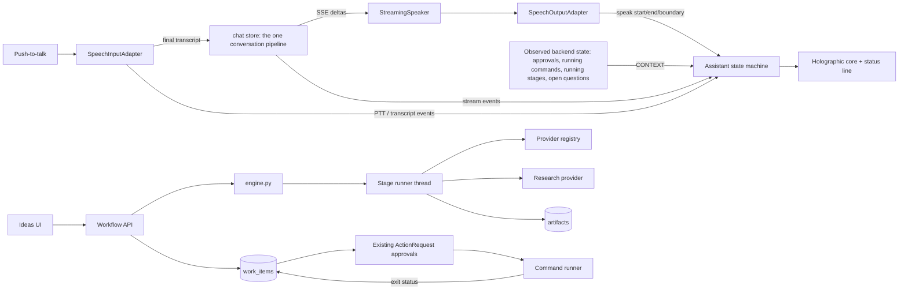
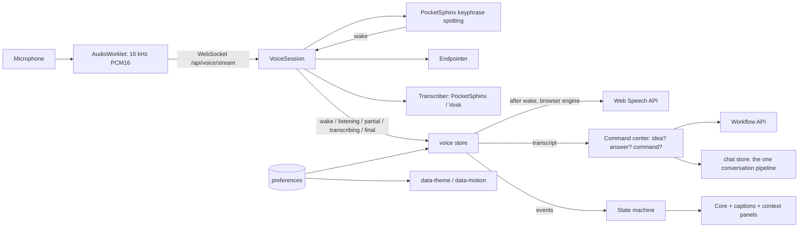
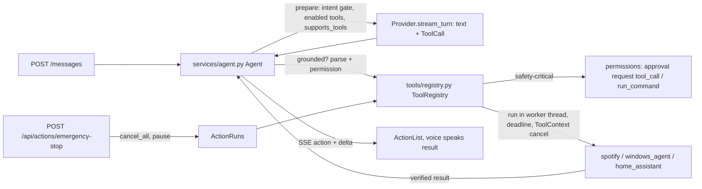

# Architecture

NOVA is a **modular monolith**: one Python process, one SQLite database, one React single-page app.
Boundaries are kept in modules rather than services so a single developer can follow any request end to end.

## Request flow

1. The browser calls `/api/...` on the same origin (Vite proxies in development; FastAPI serves `frontend/dist`
   in production).
2. A middleware enforces `X-NOVA-Client: web` on state-changing requests, the request size limit, and adds
   security headers (CSP, frame denial, no-referrer, no-store on API responses).
3. `get_auth` resolves the session cookie (only its SHA-256 digest is stored) and checks the CSRF token for
   unsafe methods. Every resource lookup checks ownership (`owned_project`, `_owned`, …) and answers 404 for
   other users' resources.
4. Routers stay thin; logic lives in `app/services`, `app/workspaces`, `app/permissions`, `app/tools`.

## Modules

| Module | Responsibility |
|---|---|
| `core/config.py` | Typed settings from `NOVA_*` environment variables / `.env`. |
| `core/errors.py` | One error shape for every failure: `{"error": {code, message, details}}`. |
| `core/logging.py` | JSON-lines logging with key- and pattern-based secret redaction. |
| `core/state.py` | Per-app state: settings, DB, provider registry, research provider, command runner, rate limiters, setup code. |
| `db/` | Engine/session factory (SQLite pragmas: foreign keys, WAL) and programmatic Alembic upgrade. |
| `models/` | ORM entities (see DATA_MODEL.md). Datetimes are always timezone-aware UTC. |
| `security/` | Argon2id hashing, token generation, constant-time compare, sliding-window rate limiter. |
| `services/auth.py` | Owner setup (one-time code), login, sessions, password change (revokes all sessions). |
| `services/assistant.py` | Provider/model resolution and system-prompt assembly with explicit trust boundaries. |
| `services/changes.py` | Change proposals: diff, base hash, apply (hash-bound), reject, revert from backup. |
| `services/audit.py` | Audit trail with redacted details. |
| `providers/` | `AIProvider` interface (`status`, `stream`, `complete`), Ollama and Anthropic implementations, registry. |
| `workspaces/` | Path normalisation, confinement (incl. symlinks), sensitive-file policy, size/binary limits, atomic writes. |
| `permissions/` | Category table, parameter hashing, single-use, expiring approvals. |
| `tools/commands.py` | Argument validation, allowlist, minimal environment, timeout, output cap, cancellation. |
| `tasks/` | Background threads that run approved commands and record results + audit events. |
| `research/` | `ResearchProvider` interface, SearXNG implementation, disabled provider with an explicit message. |

## AI providers

`AIProvider.stream()` yields text deltas and raises `ProviderFailure(message, kind, retryable)` on any error.
The conversation engine never substitutes a fallback answer: failures are streamed to the UI as an `error`
event and stored on the assistant message with status `error`.

`ProviderStatus` keeps four facts separate: `configured` (settings exist), `reachable` (a live call just
succeeded), `models` (what the provider reported) and `error` (the real failure). Adding a provider means
implementing the interface and registering it in `providers/registry.py`.

## Streaming and cancellation

`POST /api/conversations/{id}/messages` stores the user message, creates an assistant message with status
`streaming`, and returns an SSE stream. Each delta is forwarded; at the end the content and final status
(`complete`, `error` or `cancelled`) are persisted in a fresh DB session. If the client disconnects (the UI's
Stop button aborts the fetch), the generator stops and the partial text is kept as `cancelled`. On startup,
messages and tasks left in `streaming`/`running` by a crash are marked as interrupted.

## Prompt trust boundaries

The system prompt is built in this order: NOVA's base rules → memory the user explicitly saved → the active
project's description and instructions (labelled as preferences that cannot change permissions). File contents,
file trees and web snippets are wrapped in `<untrusted_data source="…">` blocks and the model is told to treat
them as data. Regardless of what the model says, it cannot act: every action is a server-side proposal that the
user approves. The model never chooses file paths for AI-proposed changes.

## Frontend

- `api/client.ts` — typed fetch wrapper (CSRF + client header), SSE parser, endpoint helpers.
- `store/` — `session` (auth), `chat` (conversation list, current conversation, streaming, presence), `providers`.
  The chat store is global so navigating away never loses a conversation or an in-flight generation.
- `components/` — layout shell (rail, top bar with live model status, activity panel), presence ring, safe
  Markdown (no raw HTML; Mermaid in strict mode, lazy-loaded), diff viewer, approval dialog, modal with focus trap.
- `pages/` — the twelve screens; project screens are tabs under `/projects/:id/*`.

## Key decisions and trade-offs

| Decision | Why | Trade-off |
|---|---|---|
| Modular monolith, SQLite | Zero-ops, fast, one file to back up | One writer at a time; fine for a personal tool |
| Server-side sessions + CSRF header | Revocable, nothing sensitive in the browser | Requires DB lookup per request |
| Threads for commands | No broker needed locally | Tasks don't survive restarts (they are marked interrupted) |
| Full-file proposals (not patches) | Simple, exact approval by hash, easy revert | Large files produce large proposals (1 MB cap) |
| Browser speech APIs | No model download, works now | Recognition quality/privacy depend on the browser |
| SearXNG for research | Self-hostable, no API key | Requires running SearXNG |

## 0.2 additions

### Assistant state machine (`frontend/src/assistant/machine.ts`)

0.3 (v2): foreground states — `wake_detected`, `listening`, `transcribing`, `understanding`, `thinking`, `responding`,
`speaking`, `interrupted`, `cancelled`, `error` — change only through the explicit `TRANSITIONS` table on events
emitted by real code paths (`WAKE`, `PTT_START`, `LISTEN_START`, `LISTEN_END`, `SEND`, `ACCEPTED` on the SSE `start`
event, `FIRST_DELTA`, `STREAM_DONE`, `ABORTED`, `SPEAK_*`, `VOICE_ERROR`, …). When no foreground activity exists, the
displayed state is derived from observed backend context, by priority: `executing` > `researching` / `designing` >
`awaiting_approval` > `awaiting_user` > `standby`. `interrupted`, `cancelled` and a wake phrase with nothing said after
it return to standby after a short pause (`AUTO_RETURN_MS`, scheduled by the store, never used to simulate work);
errors stay until the owner dismisses them. Tests: `frontend/src/test/machine.test.ts`.

### Voice

`voice/types.ts` defines `SpeechInputAdapter` and `SpeechOutputAdapter`; `voice/browser.ts` implements them with the Web
Speech API. `store/voice.ts` orchestrates push-to-talk, barge-in and interruption and subscribes to the chat store's stream
events, so spoken replies are the model's actual output. `voice/mic.ts` opens a separate level meter only while
listening (for the waveform) and closes it afterwards.

### Holographic core

`hologram/CoreScene.ts` (three.js, lazy chunk) renders a wire core, ringed markings, sweeping arcs, a research scan, a
design lattice and a particle field. It reacts to the assistant state, the real microphone level and real speech word
boundaries. With `prefers-reduced-motion` it renders static frames on state changes only. Without WebGL,
`HoloCore` renders an SVG core with the same states.

### Workflows (`backend/app/workflows/`)

- `templates.py` — reusable checklists (topics ordered by consequence, research questions with source categories,
  guidance, task skeletons). Not domain logic: the plant-health example uses the generic image-recognition template.
- `engine.py` — stage state in `workflows.stage_state` (JSON), questions, research findings, artifact storage that never
  overwrites edited documents, proposal and decision logic, serialization.
- `drafts.py` — documents assembled from the owner's answers when no AI model is reachable.
- `runner.py` — runs one stage per workflow in a background thread with its own event loop and DB session; cancellable;
  interrupted stages are marked on startup.

### Task engine (`services/work.py`, `services/suggestions.py`)

Work items have a status machine for manual tasks, and status follows observed results for command and document tasks.
Command tasks reuse `ActionRequest` (parameter-bound, single-use approvals); hooks in `api/actions.py` and `tasks/` update
the task on approval, rejection, expiry and the command's exit status. Suggestions are computed on request from the
database (pending approvals, questions, proposals, failed stages, ready/failed/blocked tasks, pending changes).

## 0.3 additions

* **Backend voice** (`app/voice/`): `engines.py` wraps PocketSphinx keyphrase spotting (wake detector with three
  sensitivity thresholds and a dictionary check for the phrase), PocketSphinx and optional Vosk transcribers, and reports
  engine availability with reasons. `session.py` is a pure state machine per connection (wake → capturing → finishing,
  paused while the browser recognises, push-to-talk and follow-up capture) with an adaptive energy endpointer.
  `api/voice.py` authenticates the WebSocket (loopback, Origin, session cookie, CSRF hello), runs decoding in a worker
  thread and audits start/end without content.
* **Frontend voice**: `voice/capture.ts` (getUserMedia → AudioWorklet `public/audio/pcm-worklet.js`, permission errors
  mapped to recoverable states), `voice/localStream.ts` (protocol client, chime), `store/voice.ts` (arms the detector from
  the owner's preferences, routes transcripts, barge-in, follow-up, push-to-talk via browser or local engine).
* **Command center routing** (`pages/command/CommandCenter.tsx`): every input goes through one handler — an idea's open
  question gets the answer (or a spoken command from `assistant/intent.ts`), an idea-shaped sentence starts a workflow
  with `template: "auto"`, anything else goes to the conversation. Side panels render only when they have content.
* **Themes**: CSS custom properties per `data-theme`; `store/prefs.ts` resolves system preferences, applies them before
  the first paint, saves them per owner and caches them locally. `hologram/CoreScene.ts` switches palettes and blending
  (additive on dark, normal on light) and follows reduced motion at runtime.
* **Capabilities** (`services/capabilities.py`): each domain reports `available` / `limited` / `unavailable` from live
  checks of the selected model (including `supports_images`), the search provider and the speech engines.
* **Images**: `services/attachments.py` (content sniffing, owner-scoped storage, claim on send), `ChatMessage.images`
  encoded per provider (Anthropic image blocks, Ollama `images`), refused when a provider reports no vision support.

## 0.4.1 additions: model-driven actions

* **Providers** (`providers/base.py`): `ToolSpec`, `ToolCall`, `ChatMessage.tool_calls`, role `"tool"`,
  `supports_tools()` and `stream_turn()`.
  - Ollama sends `tools` to `/api/chat` and reads `message.tool_calls`; capability comes from `/api/show`.
  - Anthropic sends `tools`, reads `tool_use` blocks, and groups tool results into one user turn.
  - Providers without tools raise `tools_unsupported`, and the conversation falls back to plain streaming with a
    prompt that says why NOVA cannot act.
* **Agent** (`services/agent.py`).
  - **Offering tools:** tools go to the model only for requests to act (`services/intent.py`), and project-only tools
    only when a project is attached.
  - **Holding text:** the model's text is held for 240 characters, so claims made before a tool call are not shown.
  - **Per call:** grounding check, schema and permission (via the registry), approval queuing, execution through
    `ToolRegistry.run` with a watcher that cancels on disconnect, then audit.
  - **Limits:** 5 rounds, 6 calls, 2 identical calls, 240 s.
  - **Ending:** a result that is not `succeeded` (other than a correctable bad argument) ends the request with NOVA's
    own report. A choice among listed candidates is resolved by NOVA and replayed as an exact call (by Spotify URI).
  - `ActionRuns` tracks running `ToolContext`s for the emergency stop and for shutdown.
* **Registry** (`tools/registry.py`).
  - Risk classes: `READ`/observe, `ROUTINE`/reversible, `APPROVAL`/safety-critical, plus per-call `classify`
    (it can only make a call stricter).
  - `ToolContext` carries the deadline, a cancel event, the pause flag and the project workspace.
  - `execute()` is synchronous and catches everything. `run()` adds an external deadline.
* **Integrations.**
  - `tools/spotify.py`: search and match, device launch and wait, play by search or URI, polled verification, bounded
    retries.
  - `tools/windows_agent.py`: typed desktop tools with allowlists.
  - `tools/desktop_os.py`: launch, process list and media keys through ctypes, no shell.
  - `tools/home_assistant.py`: entity allowlist, risk per domain, state verification.
* **Frontend.**
  - `components/ActionCard.tsx` renders `Message.actions`.
  - `store/chat.ts` forwards `action` events.
  - `store/voice.ts` speaks finished action results instead of the model's text for that reply. The old client-side
    Spotify pattern matcher was removed, so typed and spoken requests share one pipeline.
  - `pages/settings/ActionsSettings.tsx` holds the tool status and the emergency stop.
  - The approval dialog shows device results honestly.
