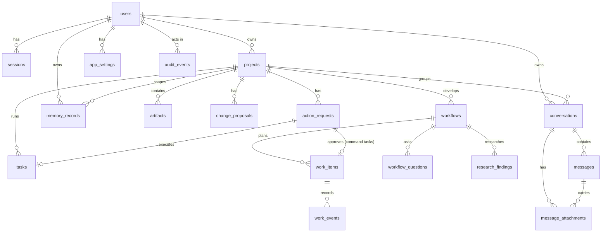

# Data model

SQLite database `NOVA_DATA_DIR/nova.db`, schema managed by Alembic (`backend/migrations`). Foreign keys are
enforced (`PRAGMA foreign_keys=ON`). All timestamps are UTC. No secret (API key, raw password, raw session
token) is stored in any table.

| Table | Purpose | Key columns |
|---|---|---|
| `users` | Local accounts | `username` (unique, lower-case), `password_hash` (Argon2id), `is_owner` |
| `sessions` | Server-side sessions | `token_hash` (SHA-256 of the cookie), `csrf_token`, `expires_at` |
| `projects` | Project and its workspace | `owner_id`, `name`, `description`, `instructions`, `workspace_path`, `archived` |
| `conversations` | Chat threads | `owner_id`, `project_id` (nullable, SET NULL on project delete), `title`, last `provider`/`model`, `mode` (0.3: general/engineering/research/product/design/business/learning) |
| `messages` | Chat messages | `role` (user/assistant), `content`, `status` (complete/streaming/error/cancelled), `error`, `provider`, `model`, `actions` (0.4.1: JSON list of the tool calls NOVA ran for the reply with their real status, message and verification; null when none) |
| `artifacts` | Analyses and design documents | `project_id`, `kind`, `title`, `content` (Markdown), `created_by` (user/ai), `source_input` |
| `change_proposals` | Reviewable file changes | `path` (workspace-relative), `operation` (create/modify), `original_content` (backup), `base_sha256`, `proposed_content`, `proposed_sha256`, `diff`, `source`, `status` (pending/applied/rejected/reverted/stale) |
| `action_requests` | Category C approvals | `project_id` (null for device actions since 0.4.1), `kind` (run_command/delete_path/move_path/tool_call), `category`, `params` (JSON; for `tool_call`: `tool` and `arguments`), `params_hash`, `reason`, `reversible`, `status` (pending/approved/rejected/expired) |
| `tasks` | Executions of approved commands | `action_id`, `command` (argv JSON), `status` (queued/running/succeeded/failed/cancelled/timed_out), `exit_code`, `stdout`, `stderr`, `duration_seconds` |
| `audit_events` | Audit trail | `user_id`, `action` (e.g. `change.applied`), `target` (e.g. `project:3:src/app.py`), `outcome` (success/denied/failure), redacted `details`, `ip` |
| `memory_records` | Explicitly saved memory | `kind` (preference/fact/note), `content`, `project_id` (null = general), `source` (provenance), `enabled` |
| `workflows` (0.2) | Idea-to-product workflows | `idea`, `template`, `status` (active/awaiting_decision/approved/rejected/archived), `current_stage`, `stage_state` (JSON: status, mode, error, artifact ids + content hashes per stage), `revision_notes`, `proposal_artifact_id`, `proposal_sha256` |
| `workflow_questions` (0.2) | Clarifying questions | `topic`, `question`, `rationale`, `options`, `source` (template/ai), `status` (open/answered/skipped), `answer` |
| `research_findings` (0.2) | Research questions and real results | `question`, `source_categories`, `status` (pending/sourced/no_results/failed), `provider`, `results` (title, url, snippet) |
| `work_items` (0.2) | Tasks in any domain | `title`, `description`, `domain`, `executor` (manual/command/artifact), `status`, `inputs`, `outputs`, `depends_on`, `requires_approval`, `action_id`, `source` (user/template/ai), `error`, `position` |
| `work_events` (0.2) | Progress events for tasks and workflows | `work_item_id` or `workflow_id`, `kind` (status/progress/error/output/note), `message`, `data` |
| `message_attachments` (0.3) | Images attached to messages | `owner_id`, `conversation_id`, `message_id` (null until sent), `filename`, `mime`, `size`, `sha256`, `storage_name` (random file name under `data/uploads/<owner_id>/`) |
| `app_settings` | Per-user settings | (`user_id`, `key`) unique, JSON `value` (e.g. selected provider/model; 0.3 `preferences`: theme, motion, suggestions, voice settings, wake consent time; 0.4.1 `actions_paused`: emergency stop) |

**Provider configuration** (base URLs, model names, API keys) comes from environment variables, not the
database; the selected provider/model per user is stored in `app_settings`.

**Deletion behaviour**
- Deleting a project removes its artifacts, proposals, action requests, tasks, workflows, work items and project memory (CASCADE);
  its conversations are kept and detached. Workspace files on disk are **not** deleted.
- Deleting a conversation removes its messages and its image attachments (database rows and files). Deleting a memory
  record removes it immediately. Microphone audio is never stored, so there is nothing to delete.
- SQLite may keep freed pages until `VACUUM`; backups you made of `data/` are not affected by deletions.

**Migrations**
- `0001_initial_schema` creates the 0.1 tables; `0002` adds workflows, questions, research findings, work items and events;
  `0003` adds `conversations.mode` and `message_attachments`; `0004` (0.4.1) adds `messages.actions` and makes
  `action_requests.project_id` nullable. `alembic check` verifies models and migrations are in sync.
